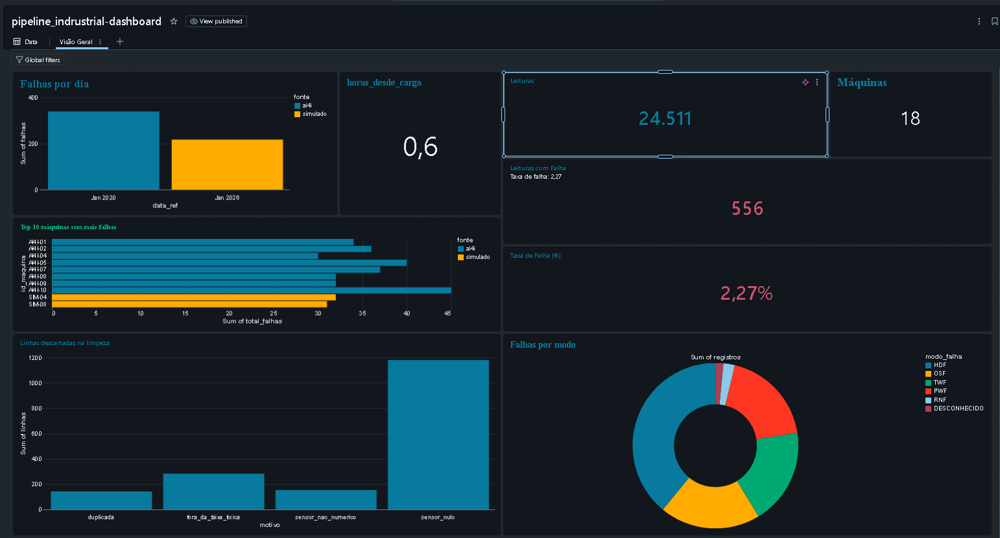
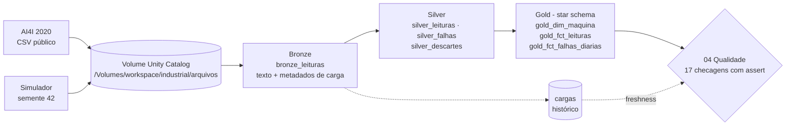
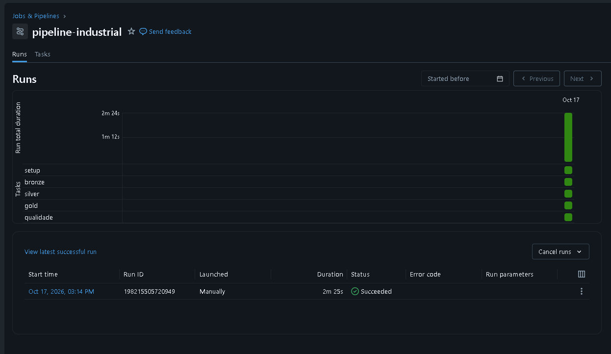
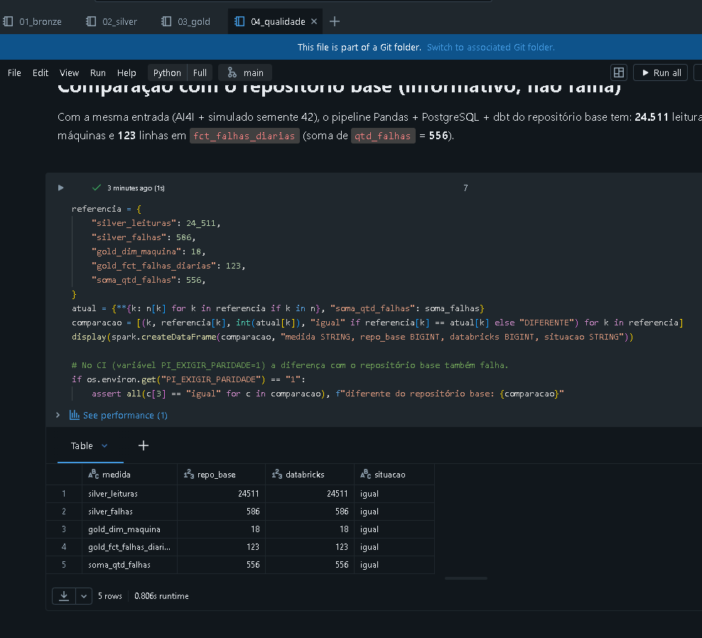

# pipeline-industrial-databricks

[](https://github.com/DenisPaulo/pipeline-industrial-databricks/actions/workflows/ci.yml)


**V4 do portfólio de Engenharia de Dados:** o mesmo problema do repositório base
[pipeline-dados-industriais](https://github.com/DenisPaulo/pipeline-dados-industriais), agora resolvido no
**Databricks** com **PySpark** e **Delta Lake**, na arquitetura **medallion** (bronze → silver → gold).



*Resultado final: [dashboard AI/BI](#dashboard-aibi) no Databricks sobre as tabelas gold (24.511 leituras, 556 com falha, 2,27%).*

## Problema

Máquinas têm sensores (temperatura, rotação, torque, desgaste da ferramenta) e às vezes falham.
Os dados chegam **sujos**: valores vazios, leituras impossíveis (999,9 K), texto no lugar de número,
linhas duplicadas. A pergunta de negócio é simples: **quais máquinas falham mais, em que dias e de
que jeito?** Para responder com confiança, é preciso limpar, modelar e testar os dados.

## Arquitetura medallion



| Camada | O que guarda | Pra que serve |
|---|---|---|
| **Bronze** | Os dados **como chegaram** (tudo texto) + `_id_carga`, `_carregado_em`, `_arquivo_origem` | Ter uma cópia fiel; dá para refazer a limpeza sem buscar a fonte de novo |
| **Silver** | Dados **limpos e tipados**; descartes com o **motivo** | Base confiável; saber exatamente por que cada linha foi rejeitada |
| **Gold** | **Modelo estrela** pronto para análise | Consultas e painéis rápidos e simples |

Todas as tabelas são **Delta** (formato aberto com transações, histórico de versões e `overwrite`
seguro) e ficam no **Unity Catalog**, em `workspace.industrial`.

## De Hive/HDFS para Databricks + Delta

Em um ambiente Hadoop, as tabelas ficam no **Hive Metastore**: ele guarda o nome, as colunas e o
caminho dos arquivos, e os arquivos (em geral **Parquet**) ficam no **HDFS**.

A migração para o Databricks registra esses dados como tabelas **Delta Lake** no **Unity Catalog**.
O Delta Lake mantém arquivos abertos e acrescenta o comportamento de uma tabela transacional:

| Recurso | Para que serve |
|---|---|
| **ACID** | Leituras e gravações concorrentes deixam a tabela num estado consistente |
| **Time travel** | Consultar uma versão anterior, pelo número da versão ou por um horário |
| **MERGE** | Atualizar as linhas que já existem e inserir as novas na mesma operação |
| **Histórico** | Ver o que cada gravação alterou |

Neste repositório as tabelas nascem em Delta. O `CREATE TABLE ... USING DELTA` está no notebook
[`01_bronze`](notebooks/01_bronze.py), na tabela de histórico `cargas`:

```sql
CREATE TABLE IF NOT EXISTS workspace.industrial.cargas (
    id_carga STRING,
    carregado_em TIMESTAMP,
    linhas_bronze BIGINT,
    linhas_ai4i BIGINT,
    linhas_simulado BIGINT
) USING DELTA
```

No Databricks, `tabela("cargas")` (definida em [`_config`](notebooks/_config.py)) resolve para
`workspace.industrial.cargas`. `bronze_leituras`, as tabelas silver e as tabelas gold são gravadas
com `.format("delta")` nos notebooks `01_bronze`, `02_silver` e `03_gold`.

## Notebooks

Ficam em [`notebooks/`](notebooks), no formato `.py` do Databricks (`# Databricks notebook source`).
Rode **na ordem**:

| Notebook | O que faz |
|---|---|
| [`00_setup`](notebooks/00_setup.py) | Cria o schema `workspace.industrial` e o volume `arquivos`; coloca o CSV do AI4I no volume (baixa do UCI ou usa a cópia em [`dados/`](dados)); gera as leituras simuladas |
| [`01_bronze`](notebooks/01_bronze.py) | Lê os CSVs como texto, padroniza o AI4I (máquinas virtuais + horário), grava `bronze_leituras` e registra a execução em `cargas` |
| [`02_silver`](notebooks/02_silver.py) | Limpeza com as mesmas 8 regras do repositório base (um motivo por linha), tipagem, duplicadas, faixas físicas; grava `silver_leituras`, `silver_falhas`, `silver_descartes` |
| [`03_gold`](notebooks/03_gold.py) | Star schema equivalente ao dbt: `gold_dim_maquina`, `gold_fct_leituras`, `gold_fct_falhas_diarias` |
| [`04_qualidade`](notebooks/04_qualidade.py) | 17 checagens (volume, conservação entre camadas, nulos, unicidade, relacionamento, valores aceitos, freshness) que **falham com `assert`**; compara com os números do repositório base |
| [`dashboards/consultas.sql`](dashboards/consultas.sql) | 6 consultas SQL do AI/BI Dashboard (veja a seção Dashboard) |
| [`_config`](notebooks/_config.py) | Nomes e regras compartilhados (carregado pelos outros com `%run ./_config`) |
| [`simulador.py`](notebooks/simulador.py) | Gerador das leituras simuladas (cópia do repositório base) |

Tudo pode ser rodado de novo: bronze, silver e gold são sobrescritas; só `cargas` acumula (é o histórico).

## Como importar e rodar no Databricks Free Edition (passo a passo)

1. Entre no seu workspace do **Databricks Free Edition**.
2. No menu da esquerda, clique em **Workspace**.
3. Abra a sua pasta de usuário (**Users › seu e-mail**) e clique em **Create › Git folder**.
4. Em **Git repository URL**, cole `https://github.com/DenisPaulo/pipeline-industrial-databricks`
   (o provedor **GitHub** é detectado sozinho; repositório público não precisa de token) e clique em
   **Create Git folder**.
5. Abra a pasta criada › **notebooks** › **00_setup**.
6. No topo do notebook, em **Connect**, escolha **Serverless** (é a única opção no Free Edition).
7. Clique em **Run all**. No fim deve aparecer `AI4I: ... — 10000 linhas` e
   `simulado: ... — 16271 linhas`.
8. Repita **Run all** em **01_bronze**, **02_silver**, **03_gold** e **04_qualidade**, nessa ordem.
   No 04, o esperado é `17 de 17 checagens passaram`.
9. Veja as tabelas em **Catalog › workspace › industrial** (e os arquivos em **Volumes › arquivos**).

> **Internet bloqueada?** O Free Edition limita o acesso de saída. Se o download do UCI falhar, o
> `00_setup` avisa e usa a cópia `dados/ai4i2020.csv` que veio com o Git folder. Se mesmo assim der
> erro, faça o upload manual: **Catalog › workspace › industrial › arquivos › Upload to this volume**,
> pasta `ai4i/`, arquivo `ai4i2020.csv`, e rode o `00_setup` de novo.

Para atualizar depois de um `git push`: abra o Git folder, clique no nome do branch (`main`) e em **Pull**.

## Resultado esperado

Mesma entrada do repositório base (AI4I + simulado com semente 42) ⇒ mesmos números (no teste local/CI **e** no Databricks):

| Medida | Valor |
|---|---|
| `bronze_leituras` | 26.271 (10.000 AI4I + 16.271 simuladas) |
| `silver_leituras` | 24.511 |
| `silver_descartes` | 1.760 (sensor_nulo 1.180 · fora_da_faixa_fisica 283 · sensor_nao_numerico 154 · duplicada 143) |
| `silver_falhas` | 586 |
| `gold_dim_maquina` | 18 |
| `gold_fct_leituras` | 24.511 |
| `gold_fct_falhas_diarias` | 123 (soma de `qtd_falhas` = 556) |

## Executado no Databricks Free Edition

Os 5 notebooks foram importados por **Git folder** e rodados no **Databricks Free Edition**
(compute Serverless, Unity Catalog `workspace.industrial`) em **17/10/2026**:

- Todos os notebooks terminaram sem erro; o `04_qualidade` passou nas checagens.
- A comparação com o repositório base deu **igual** nas 5 medidas (24.511 leituras, 586 registros de
  falha, 18 máquinas, 123 linhas em `fct_falhas_diarias`, soma 556).
- O Job `pipeline-industrial` (setup → bronze → silver → gold → qualidade) rodou com **Succeeded**
  em **2 min 25 s** (execução manual de 17/10/2026, 15h14, horário de Brasília).

**Job no Databricks** (as 5 tarefas verdes):



**Comparação do `04_qualidade` com o repositório base:**



## Como criar o Job (orquestração no Databricks)

Um **Job** roda os notebooks em sequência, como a DAG do Airflow no repositório base.
Se uma tarefa falhar (por exemplo, um `assert` do `04_qualidade`), as seguintes não rodam e a
execução fica vermelha.

1. Menu da esquerda › **Jobs & Pipelines** › **Create** › **Job**. Dê o nome `pipeline-industrial`.
2. Primeira tarefa: **Task name** `setup`, **Type** `Notebook`, **Source** `Workspace`,
   **Path** = `notebooks/00_setup` dentro do seu Git folder, **Compute** `Serverless`. **Create task**.
3. Clique em **+ Add task › Notebook** para cada uma das outras, sempre com **Depends on** apontando
   para a anterior:

| Tarefa | Notebook | Depende de |
|---|---|---|
| `setup` | `notebooks/00_setup` | — |
| `bronze` | `notebooks/01_bronze` | `setup` |
| `silver` | `notebooks/02_silver` | `bronze` |
| `gold` | `notebooks/03_gold` | `silver` |
| `qualidade` | `notebooks/04_qualidade` | `gold` |

4. **Run now** para testar. Para rodar todo dia: **Schedules & Triggers › Add trigger › Scheduled**.

### Job como código (Databricks Asset Bundle, opcional)

O mesmo Job está descrito em código em [`databricks.yml`](databricks.yml) +
[`resources/job.yml`](resources/job.yml). Um **Asset Bundle** permite criar e atualizar o Job pela
**Databricks CLI**, versionado no Git, em vez de clicar na interface (boa prática de
*infraestrutura como código*). O agendamento diário (06:00, Brasília) vem **pausado**.

```bash
# Instale a Databricks CLI e faça login no seu workspace (abre o navegador):
databricks auth login --host https://<seu-workspace>.cloud.databricks.com
databricks bundle validate                       # confere o YAML
databricks bundle deploy                         # cria/atualiza o Job "[dev seu_usuario] pipeline-industrial"
databricks bundle run pipeline_industrial        # roda e mostra o resultado
```

No modo `development`, o bundle envia os arquivos para uma pasta própria e cria um Job com o prefixo
`[dev ...]`, sem mexer no Job criado pela interface.

## Dashboard (AI/BI)

Um **AI/BI Dashboard** é um painel do próprio Databricks: você escreve consultas SQL (os *datasets*)
e monta gráficos em cima delas, sem instalar nada. As 6 consultas estão em
[`dashboards/consultas.sql`](dashboards/consultas.sql) e foram testadas no teste local/CI
(cada uma precisa devolver linhas).

| # | Dataset | O que mostra | Gráfico sugerido |
|---|---|---|---|
| 1 | `kpis` | total de leituras, leituras com falha, taxa de falha (%), nº de máquinas | 4 × **Counter** |
| 2 | `falhas_por_dia` | falhas por dia, separadas por fonte | **Bar** (X `data_ref`, Y `falhas`, cor `fonte`) |
| 3 | `top10_maquinas` | as 10 máquinas com mais falhas | **Bar** horizontal (Y `id_maquina`, X `total_falhas`) |
| 4 | `falhas_por_modo` | registros por modo de falha (TWF, HDF, PWF, OSF, RNF, DESCONHECIDO) | **Pie** ou **Bar** |
| 5 | `descartes_por_motivo` | linhas descartadas na silver por motivo | **Bar** (X `motivo`, Y `linhas`) |
| 6 | `ultima_carga` | quando foi a última carga e quantas horas faz | **Counter** (`horas_desde_carga`) ou **Table** |

Com os dados padrão: 24.511 leituras, 556 com falha, **2,27%**, 18 máquinas.


*Dashboard publicado no Databricks Free Edition, lendo as tabelas gold/silver.*

### Passo a passo

1. Rode antes os notebooks 00 a 03 (ou o Job), para as tabelas existirem.
2. Menu da esquerda › **Dashboards** › **Create dashboard**. Dê um nome, por exemplo `pipeline-industrial`.
3. No topo, confira o **SQL warehouse** (no Free Edition há um warehouse serverless pronto para uso).
4. Aba **Data** › **+ Add SQL dataset**. Cole a consulta **[1]** de `dashboards/consultas.sql`, clique em
   **Run** e renomeie o dataset para `kpis`. Repita para as consultas [2] a [6] (um dataset cada).
5. Vá para a aba do painel, que aparece como **Untitled page** (dê dois cliques para renomear, ex.:
   `Visão Geral`). Clique em **Add a visualization** (ícone de gráfico na barra de baixo) e clique no
   espaço do painel para criar o widget.
6. No painel da direita, escolha o tipo de gráfico da tabela acima. O **dataset** é escolhido ao clicar no
   **+** do primeiro campo (**X axis** nos gráficos de barra; **Value** no Counter). Depois preencha os
   outros campos (Y axis, Color). Para os KPIs, use **Counter** e escolha a coluna (ex.: `taxa_falha_pct`).
   Dica: em `falhas_por_dia`, se o eixo X agrupar por mês, troque a granularidade da data para **Day**.
7. Opcional: **Add a text box** para um título, e organize os gráficos arrastando.
8. **Publish** (canto superior direito). A versão publicada é a que outras pessoas veem.

### Atualizar o dashboard pelo Job

Para o painel ser atualizado logo depois do pipeline: no Job `pipeline-industrial`, **+ Add task**,
escolha o tipo **Dashboard** (se aparecer a opção no seu workspace), selecione o dashboard publicado e o
SQL warehouse, e em **Depends on** escolha `qualidade`. Assim o painel só atualiza se todas as
checagens do `04_qualidade` passarem. Se o tipo **Dashboard** não aparecer, use o agendamento do próprio
dashboard: **Schedule** › **Add schedule** (por exemplo, todo dia depois do horário do Job).

## Relação com o repositório base

| | [pipeline-dados-industriais](https://github.com/DenisPaulo/pipeline-dados-industriais) (base) | Este repositório (V4) |
|---|---|---|
| Processamento | Python + Pandas | PySpark |
| Armazenamento | Parquet + PostgreSQL | Delta Lake no Unity Catalog |
| Camadas | bruto → staging → intermediate → marts (dbt) | bronze → silver → gold |
| Qualidade | testes do dbt + freshness + volume | `04_qualidade` com `assert` |
| Orquestração | Airflow | Job do Databricks (`pipeline-industrial`) |

As regras de limpeza e o modelo estrela são **os mesmos**, para dar para comparar as duas abordagens.
Faz parte da estratégia de portfólio: um repositório por tecnologia, todos com o mesmo domínio.

## Teste local com PySpark

O job `notebooks-local` do CI faz três coisas, nesta ordem: o lint, os testes `pytest` das
transformações (bronze → silver → gold) e o script `scripts/rodar_local.py`. O script executa os 5
notebooks com **PySpark 4.0.1** e **Delta Lake**, confere a qualidade e roda as consultas do dashboard.
O job `imagem-docker` constrói a imagem abaixo e abre uma `SparkSession` dentro dela.

Os testes em [`tests/`](tests) sobem uma `SparkSession` local e atravessam os notebooks `01_bronze`,
`02_silver` e `03_gold` com um CSV pequeno: uma linha para cada regra de limpeza da silver, mais o
padrão do AI4I (máquinas virtuais e horário).

No PC as tabelas ficam em `industrial.<nome>`, numa pasta temporária. No Databricks elas ficam no
Unity Catalog, em `workspace.industrial`.

Requisitos: **Python 3.12**, **JDK 17 ou 21** e cerca de 1 GB de RAM livre para o driver
(`spark.driver.memory` = `1g`). O CI usa o **Temurin 21**. O PySpark 4.0.1 deste repositório embute
o **Hadoop 3.4.1**.

### Linux e macOS

```bash
python -m venv .venv && source .venv/bin/activate
pip install -r requirements-local.txt
python -m pytest
python scripts/rodar_local.py
```

### Windows

Instale estes três programas e abra um terminal **novo** (PowerShell ou Git Bash) para eles entrarem
no `PATH`:

1. **Git para Windows**, que inclui o **Git Bash**: https://git-scm.com/download/win
2. **Python 3.12**: https://www.python.org/downloads/windows/ — no instalador, marque **Add python.exe to PATH**.
3. **JDK Temurin 17 ou 21** (o CI usa o 21): https://adoptium.net/temurin/releases/?os=windows&version=21
   — no instalador, marque **Set JAVA_HOME variable** e **Add to PATH**.

Confira no PowerShell:

```powershell
git --version
python --version
java -version
echo $env:JAVA_HOME
```

No Git Bash:

```bash
git --version
python --version
java -version
echo "$JAVA_HOME"
```

`python --version` mostra `Python 3.12.x`. `JAVA_HOME` aponta para a pasta do JDK, aquela que contém
`bin` (em geral `C:\Program Files\Eclipse Adoptium\jdk-21.<versão>-hotspot`). O `Path` inclui
`%JAVA_HOME%\bin`.

Se `JAVA_HOME` estiver vazio, grave a variável no Windows. O valor vale para o PowerShell e para o
Git Bash:

1. Tecla Windows, pesquise **variáveis de ambiente** e abra **Editar as variáveis de ambiente do sistema**.
2. **Variáveis de Ambiente**. Em variáveis do usuário, **Novo**: nome `JAVA_HOME`, valor = a pasta do
   JDK (o nome real está em `C:\Program Files\Eclipse Adoptium`).
3. Edite `Path`, **Novo**, `%JAVA_HOME%\bin`.

Para valer só na janela atual, troque `jdk-21.0.x-hotspot` pelo nome da pasta que o instalador criou
(JDK 17 usa o prefixo `jdk-17`).

PowerShell:

```powershell
$env:JAVA_HOME = 'C:\Program Files\Eclipse Adoptium\jdk-21.0.x-hotspot'
$env:Path = "$env:JAVA_HOME\bin;" + $env:Path
java -version
```

Git Bash — caminho no formato do Windows, com barra normal. O PySpark no Windows sobe a JVM pelo
`spark-class.cmd`, que junta `%JAVA_HOME%\bin\java`:

```bash
export JAVA_HOME="C:/Program Files/Eclipse Adoptium/jdk-21.0.x-hotspot"
export PATH="$JAVA_HOME/bin:$PATH"
java -version
```

Clone e entre na pasta (o mesmo comando nos dois terminais):

```bash
git clone https://github.com/DenisPaulo/pipeline-industrial-databricks.git
cd pipeline-industrial-databricks
```

#### PowerShell

```powershell
python -m venv .venv
.\.venv\Scripts\Activate.ps1
pip install -r requirements-local.txt
python -m pytest
python scripts/rodar_local.py
```

Se o PowerShell recusar `Activate.ps1`, libere a execução nesta janela e ative de novo:

```powershell
Set-ExecutionPolicy -Scope Process -ExecutionPolicy Bypass
.\.venv\Scripts\Activate.ps1
```

#### Git Bash

Na pasta do repositório (no Git Bash o caminho fica `/c/Users/.../pipeline-industrial-databricks`):

```bash
python -m venv .venv
source .venv/Scripts/activate
pip install -r requirements-local.txt
python -m pytest
python scripts/rodar_local.py
```

O fim esperado do script é a linha `OK: todos os notebooks rodaram localmente.`

#### Problemas comuns no Windows com este PySpark (4.0.1)

**`python` abre a Microsoft Store.** O alias de aplicativo está na frente do Python 3.12. Em
Configurações → Aplicativos → **Aliases de execução de aplicativo** (no Windows 11 o item fica em
Configurações avançadas do aplicativo), desligue `python.exe` e `python3.exe`. Abra um terminal novo
e rode `python --version`.

**`Java not found and JAVA_HOME environment variable is not set.`** Essa frase vem do
`spark-class2.cmd` do PySpark 4.0.1. `JAVA_HOME` aponta para a pasta do JDK (com `bin` um nível
abaixo) e o `Path` inclui `%JAVA_HOME%\bin`. Abra um terminal novo depois de gravar as variáveis.

**`HADOOP_HOME and hadoop.home.dir are unset` ou `Failed to find winutils.exe`.** Ao gravar as
tabelas Delta no disco local, o Hadoop 3.4.1 no Windows ajusta a permissão do arquivo chamando
`winutils.exe`. O pacote pip traz as bibliotecas Java; o `winutils.exe` é um binário à parte,
específico do Windows. Use um build de comunidade da linha 3.4, a pasta
[`hadoop-3.4.0-win10-x64/bin`](https://github.com/kontext-tech/winutils/tree/master/hadoop-3.4.0-win10-x64/bin)
do repositório kontext-tech/winutils:

1. Crie `C:\hadoop\bin` e copie para lá a pasta `bin` inteira (`winutils.exe`, `hadoop.dll` e os demais arquivos).
2. Crie a variável de usuário `HADOOP_HOME` com o valor `C:\hadoop`.
3. Inclua `%HADOOP_HOME%\bin` no `Path`.
4. Abra um terminal novo. `winutils.exe` responde ao ser chamado.

Se o `winutils.exe` fechar na hora com erro de DLL, instale o
[Microsoft Visual C++ Redistributable](https://learn.microsoft.com/cpp/windows/latest-supported-vc-redist)
(2015–2022, 64 bits).

**`Cannot run program "python3"`.** O valor padrão de `PYSPARK_PYTHON` no PySpark 4.0.1 é o comando
`python3` (`pyspark/core/context.py`). No Windows o Python e a venv oferecem `python.exe`. O
`scripts/rodar_local.py` preenche `PYSPARK_PYTHON` e `PYSPARK_DRIVER_PYTHON` com o interpretador que
rodou o script. Para abrir uma SparkSession direto no interpretador, com a venv já ativada:

PowerShell:

```powershell
$env:PYSPARK_PYTHON = "$PWD\.venv\Scripts\python.exe"
$env:PYSPARK_DRIVER_PYTHON = "$PWD\.venv\Scripts\python.exe"
```

Git Bash:

```bash
export PYSPARK_PYTHON="$PWD/.venv/Scripts/python.exe"
export PYSPARK_DRIVER_PYTHON="$PWD/.venv/Scripts/python.exe"
```

### Docker

Com o [Docker Desktop](https://www.docker.com/products/docker-desktop/) em execução, na pasta do
repositório. Os comandos são os mesmos no PowerShell e no Git Bash:

```bash
docker build -t pipeline-industrial .
docker run --rm pipeline-industrial
```

A imagem junta Python 3.12 e o JDK Temurin 21. O comando de entrada é `python scripts/rodar_local.py`.
A variável `PI_EXIGIR_PARIDADE=1` liga a mesma conferência de números do CI. O contêiner usa Linux,
e o Hadoop grava os arquivos Delta com as permissões do Linux. O script configura
`spark.driver.memory` em 1 GB.

## Dados e licença

- AI4I 2020 Predictive Maintenance Dataset, UCI Machine Learning Repository, licença CC BY 4.0 — veja [`dados/README.md`](dados/README.md).
- Código: [MIT](LICENSE).
