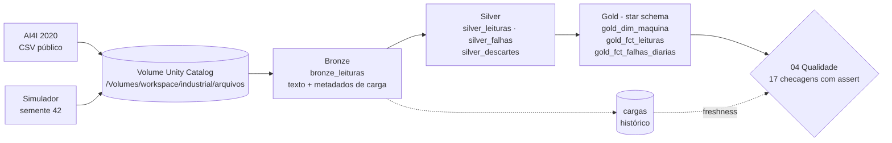
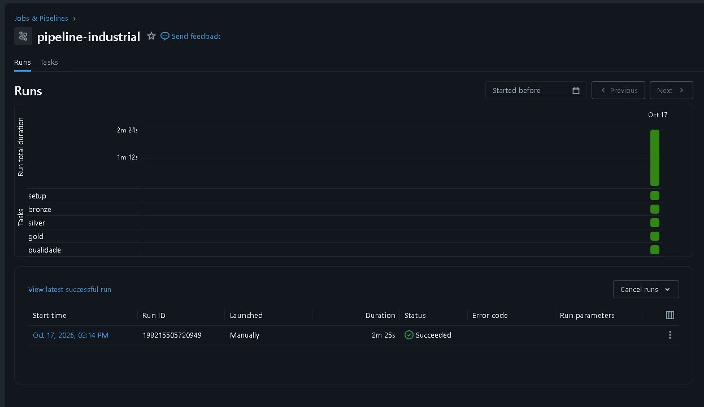
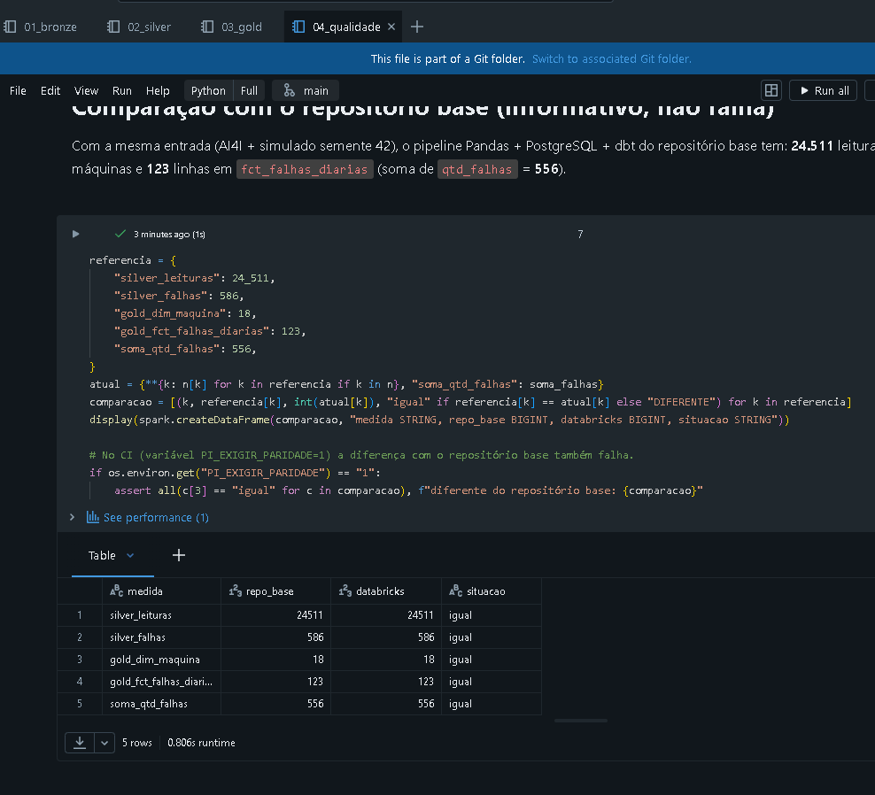

# pipeline-industrial-databricks

[](https://github.com/DenisPaulo/pipeline-industrial-databricks/actions/workflows/ci.yml)


**V4 do portfólio de Engenharia de Dados:** o mesmo problema do repositório base
[pipeline-dados-industriais](https://github.com/DenisPaulo/pipeline-dados-industriais), agora resolvido no
**Databricks** com **PySpark** e **Delta Lake**, na arquitetura **medallion** (bronze → silver → gold).

## Problema

Máquinas têm sensores (temperatura, rotação, torque, desgaste da ferramenta) e às vezes falham.
Os dados chegam **sujos**: valores vazios, leituras impossíveis (999,9 K), texto no lugar de número,
linhas duplicadas. A pergunta de negócio é simples: **quais máquinas falham mais, em que dias e de
que jeito?** Para responder com confiança, é preciso limpar, modelar e testar os dados.

## Arquitetura medallion



| Camada | O que guarda | Pra que serve |
|---|---|---|
| **Bronze** | Os dados **como chegaram** (tudo texto) + `_id_carga`, `_carregado_em`, `_arquivo_origem` | Ter uma cópia fiel; dá para refazer a limpeza sem buscar a fonte de novo |
| **Silver** | Dados **limpos e tipados**; descartes com o **motivo** | Base confiável; saber exatamente por que cada linha foi rejeitada |
| **Gold** | **Modelo estrela** pronto para análise | Consultas e painéis rápidos e simples |

Todas as tabelas são **Delta** (formato aberto com transações, histórico de versões e `overwrite`
seguro) e ficam no **Unity Catalog**, em `workspace.industrial`.

## Notebooks

Ficam em [`notebooks/`](notebooks), no formato `.py` do Databricks (`# Databricks notebook source`).
Rode **na ordem**:

| Notebook | O que faz |
|---|---|
| [`00_setup`](notebooks/00_setup.py) | Cria o schema `workspace.industrial` e o volume `arquivos`; coloca o CSV do AI4I no volume (baixa do UCI ou usa a cópia em [`dados/`](dados)); gera as leituras simuladas |
| [`01_bronze`](notebooks/01_bronze.py) | Lê os CSVs como texto, padroniza o AI4I (máquinas virtuais + horário), grava `bronze_leituras` e registra a execução em `cargas` |
| [`02_silver`](notebooks/02_silver.py) | Limpeza com as mesmas 8 regras do repositório base (um motivo por linha), tipagem, duplicadas, faixas físicas; grava `silver_leituras`, `silver_falhas`, `silver_descartes` |
| [`03_gold`](notebooks/03_gold.py) | Star schema equivalente ao dbt: `gold_dim_maquina`, `gold_fct_leituras`, `gold_fct_falhas_diarias` |
| [`04_qualidade`](notebooks/04_qualidade.py) | 17 checagens (volume, conservação entre camadas, nulos, unicidade, relacionamento, valores aceitos, freshness) que **falham com `assert`**; compara com os números do repositório base |
| [`_config`](notebooks/_config.py) | Nomes e regras compartilhados (carregado pelos outros com `%run ./_config`) |
| [`simulador.py`](notebooks/simulador.py) | Gerador das leituras simuladas (cópia do repositório base) |

Tudo pode ser rodado de novo: bronze, silver e gold são sobrescritas; só `cargas` acumula (é o histórico).

## Como importar e rodar no Databricks Free Edition (passo a passo)

1. Entre no seu workspace do **Databricks Free Edition**.
2. No menu da esquerda, clique em **Workspace**.
3. Abra a sua pasta de usuário (**Users › seu e-mail**) e clique em **Create › Git folder**.
4. Em **Git repository URL**, cole `https://github.com/DenisPaulo/pipeline-industrial-databricks`
   (o provedor **GitHub** é detectado sozinho; repositório público não precisa de token) e clique em
   **Create Git folder**.
5. Abra a pasta criada › **notebooks** › **00_setup**.
6. No topo do notebook, em **Connect**, escolha **Serverless** (é a única opção no Free Edition).
7. Clique em **Run all**. No fim deve aparecer `AI4I: ... — 10000 linhas` e
   `simulado: ... — 16271 linhas`.
8. Repita **Run all** em **01_bronze**, **02_silver**, **03_gold** e **04_qualidade**, nessa ordem.
   No 04, o esperado é `17 de 17 checagens passaram`.
9. Veja as tabelas em **Catalog › workspace › industrial** (e os arquivos em **Volumes › arquivos**).

> **Internet bloqueada?** O Free Edition limita o acesso de saída. Se o download do UCI falhar, o
> `00_setup` avisa e usa a cópia `dados/ai4i2020.csv` que veio com o Git folder. Se mesmo assim der
> erro, faça o upload manual: **Catalog › workspace › industrial › arquivos › Upload to this volume**,
> pasta `ai4i/`, arquivo `ai4i2020.csv`, e rode o `00_setup` de novo.

Para atualizar depois de um `git push`: abra o Git folder, clique no nome do branch (`main`) e em **Pull**.

## Resultado esperado

Mesma entrada do repositório base (AI4I + simulado com semente 42) ⇒ mesmos números (no teste local/CI **e** no Databricks):

| Medida | Valor |
|---|---|
| `bronze_leituras` | 26.271 (10.000 AI4I + 16.271 simuladas) |
| `silver_leituras` | 24.511 |
| `silver_descartes` | 1.760 (sensor_nulo 1.180 · fora_da_faixa_fisica 283 · sensor_nao_numerico 154 · duplicada 143) |
| `silver_falhas` | 586 |
| `gold_dim_maquina` | 18 |
| `gold_fct_leituras` | 24.511 |
| `gold_fct_falhas_diarias` | 123 (soma de `qtd_falhas` = 556) |

## Executado no Databricks Free Edition

Os 5 notebooks foram importados por **Git folder** e rodados no **Databricks Free Edition**
(compute Serverless, Unity Catalog `workspace.industrial`) em **17/10/2026**:

- Todos os notebooks terminaram sem erro; o `04_qualidade` passou nas checagens.
- A comparação com o repositório base deu **igual** nas 5 medidas (24.511 leituras, 586 registros de
  falha, 18 máquinas, 123 linhas em `fct_falhas_diarias`, soma 556).
- O Job `pipeline-industrial` (setup → bronze → silver → gold → qualidade) rodou com **Succeeded**
  em **2 min 25 s** (execução manual de 17/10/2026, 15h14, horário de Brasília).

**Job no Databricks** (as 5 tarefas verdes):



**Comparação do `04_qualidade` com o repositório base:**



## Como criar o Job (orquestração no Databricks)

Um **Job** roda os notebooks em sequência, como a DAG do Airflow no repositório base.
Se uma tarefa falhar (por exemplo, um `assert` do `04_qualidade`), as seguintes não rodam e a
execução fica vermelha.

1. Menu da esquerda › **Jobs & Pipelines** › **Create** › **Job**. Dê o nome `pipeline-industrial`.
2. Primeira tarefa: **Task name** `setup`, **Type** `Notebook`, **Source** `Workspace`,
   **Path** = `notebooks/00_setup` dentro do seu Git folder, **Compute** `Serverless`. **Create task**.
3. Clique em **+ Add task › Notebook** para cada uma das outras, sempre com **Depends on** apontando
   para a anterior:

| Tarefa | Notebook | Depende de |
|---|---|---|
| `setup` | `notebooks/00_setup` | — |
| `bronze` | `notebooks/01_bronze` | `setup` |
| `silver` | `notebooks/02_silver` | `bronze` |
| `gold` | `notebooks/03_gold` | `silver` |
| `qualidade` | `notebooks/04_qualidade` | `gold` |

4. **Run now** para testar. Para rodar todo dia: **Schedules & Triggers › Add trigger › Scheduled**.

### Job como código (Databricks Asset Bundle, opcional)

O mesmo Job está descrito em código em [`databricks.yml`](databricks.yml) +
[`resources/job.yml`](resources/job.yml). Um **Asset Bundle** permite criar e atualizar o Job pela
**Databricks CLI**, versionado no Git, em vez de clicar na interface (boa prática de
*infraestrutura como código*). O agendamento diário (06:00, Brasília) vem **pausado**.

```bash
# Instale a Databricks CLI e faça login no seu workspace (abre o navegador):
databricks auth login --host https://<seu-workspace>.cloud.databricks.com
databricks bundle validate                       # confere o YAML
databricks bundle deploy                         # cria/atualiza o Job "[dev seu_usuario] pipeline-industrial"
databricks bundle run pipeline_industrial        # roda e mostra o resultado
```

No modo `development`, o bundle envia os arquivos para uma pasta própria e cria um Job com o prefixo
`[dev ...]`, sem mexer no Job criado pela interface.

## Relação com o repositório base

| | [pipeline-dados-industriais](https://github.com/DenisPaulo/pipeline-dados-industriais) (base) | Este repositório (V4) |
|---|---|---|
| Processamento | Python + Pandas | PySpark |
| Armazenamento | Parquet + PostgreSQL | Delta Lake no Unity Catalog |
| Camadas | bruto → staging → intermediate → marts (dbt) | bronze → silver → gold |
| Qualidade | testes do dbt + freshness + volume | `04_qualidade` com `assert` |
| Orquestração | Airflow | Job do Databricks (`pipeline-industrial`) |

As regras de limpeza e o modelo estrela são **os mesmos**, para dar para comparar as duas abordagens.
Faz parte da estratégia de portfólio: um repositório por tecnologia, todos com o mesmo domínio.

## Teste local (sem Databricks)

O CI roda os 5 notebooks com PySpark + Delta Lake locais e exige os mesmos números do repositório base.
Para rodar no seu PC (precisa de **Java 17+** e ~1 GB de RAM livre):

```bash
python -m venv .venv && source .venv/bin/activate     # Git Bash no Windows: source .venv/Scripts/activate
pip install -r requirements-local.txt
python scripts/rodar_local.py
```

No local não existe Unity Catalog: as tabelas ficam em `industrial.<nome>` numa pasta temporária.

## Dados e licença

- AI4I 2020 Predictive Maintenance Dataset, UCI Machine Learning Repository, licença CC BY 4.0 — veja [`dados/README.md`](dados/README.md).
- Código: [MIT](LICENSE).
